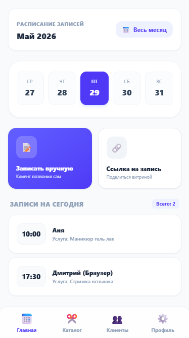
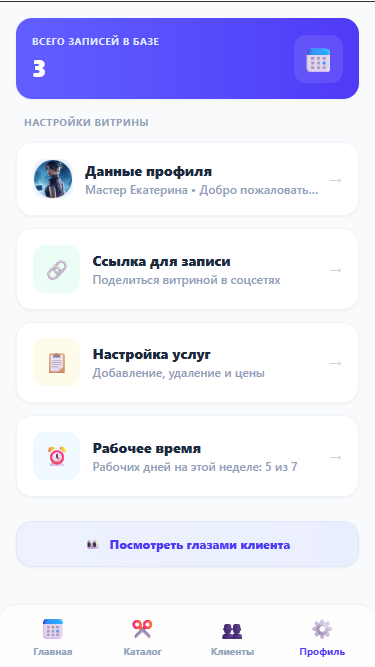
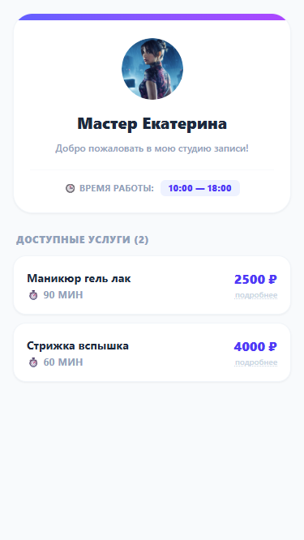
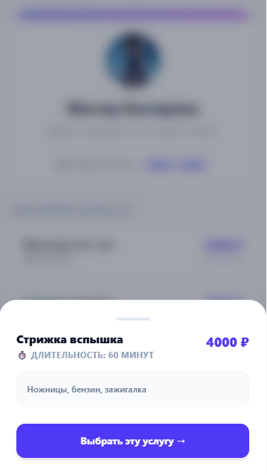

# Master Vitrina

Full-stack Telegram Mini App (TWA) для автоматизации онлайн-записи, управления расписанием и ведения клиентской базы (CRM).

**Landing Page:** [Landing](https://master-vitrina-rmjc.vercel.app/) 
**Telegram Mini App (Bot):** [@mastervitrinabot](https://t.me/mastervitrinabot)

---

<div align="center">
  <table border="0" cellpadding="0" cellspacing="0">
    <tr>
      <td width="24%" align="center" valign="top">
        
      </td>
      <td width="24%" align="center" valign="top">
        
      </td>
      <td width="24%" align="center" valign="top">
        
      </td>
      <td width="24%" align="center" valign="top">
        
      </td>
    </tr>
  </table>
</div>

---

## Технологический стек

### Frontend (`/frontend`)
- **Core:** React 19, TypeScript, Vite
- **State Management & Data Fetching:** TanStack Query (server state, кэширование, инвалидация), Zustand (client/UI state), Axios
- **Styling & UI:** Tailwind CSS v4, Lucide Icons
- **Telegram & Media:** `@twa-dev/sdk` (нативная навигация, MainButton, HapticFeedback), `browser-image-compression` (оптимизация изображений на клиенте перед загрузкой)
- **Storage & Monitoring:** `@supabase/supabase-js`, Vercel Speed Insights

### Backend (`/backend`)
- **Core:** Python 3.11+, FastAPI
- **Database & ORM:** PostgreSQL 16 (Supabase), SQLAlchemy (asyncpg), Alembic
- **Security:** JWT-авторизация с валидацией подписи `initData` от Telegram WebApp

### Инфраструктура и качество кода
- **Контейнеризация и CI:** Docker Compose, GitHub Actions
- **Тестирование:** Vitest, React Testing Library, jsdom
- **Линтинг и форматирование:** ESLint (flat config), Prettier, Husky + lint-staged

---

## Структура репозитория

```text
master-vitrina/
├── frontend/               # Клиентское SPA-приложение (Telegram Mini App)
├── backend/                # REST API сервис (FastAPI) и миграции БД
├── landing/                # Промо-лендинг проекта
├── .github/workflows/      # CI/CD и автоматизация обслуживания БД
├── docker-compose.yml      # Оркестрация сервисов для локальной разработки
└── .env.example            # Шаблон переменных окружения
```

---

## Архитектурные решения

1. **Разделение стейта:** Серверные данные, кэширование запросов и фоновое обновление изолированы в **TanStack Query**, тогда как глобальное состояние интерфейса (модальные окна, шторки, текущая сессия) управляется через **Zustand**.
2. **Оптимизация медиа на клиенте:** Загружаемые мастерами фотографии сжимаются и конвертируются непосредственно в браузере (`browser-image-compression`) до отправки в облачное хранилище, что снижает нагрузку на сеть в мобильном клиенте Telegram.
3. **Интеграция с Telegram WebApp:** Приложение адаптируется под цветовую схему клиента Telegram, использует нативную кнопку `MainButton` для целевых действий и тактильный отклик (`HapticFeedback`).
4. **Безопасность данных:** Аутентификация строится на проверке криптографической подписи `initData` на стороне бэкенда с последующей выдачей JWT-токена.

---

## Локальный запуск

### Вариант 1: Полный стек через Docker Compose

1. Клонируйте репозиторий и создайте файл конфигурации:
   ```bash
   git clone https://github.com/Vinkol/master-vitrina.git
   cd master-vitrina
   cp .env.example .env
   ```
   *(Заполните переменные окружения в `.env`)*

2. Запустите контейнеры:
   ```bash
   docker-compose up --build
   ```
   - Frontend: `http://localhost:3000`
   - Backend API / Swagger UI: `http://localhost:8000/docs`

3. *(Опционально)* Заполнение базы тестовыми данными CRM:
   ```bash
   docker exec -it twa_fastapi python -m src.seed_crm
   ```

### Вариант 2: Отладка Frontend внутри Telegram (Tunnel)

Для тестирования TWA на мобильном устройстве предусмотрен скрипт поднятия публичного HTTPS-туннеля через Serveo:

```bash
cd frontend
npm install
npm run dev:tg
```

---

## Скрипты Frontend

- `npm run dev` — запуск dev-сервера Vite
- `npm run dev:tg` — параллельный запуск Vite и SSH-туннеля (`serveo.net`) для теста в Telegram
- `npm run build` — проверка типов (`tsc`) и production-сборка
- `npm run lint` / `npm run format` — проверка и автоформатирование кода
